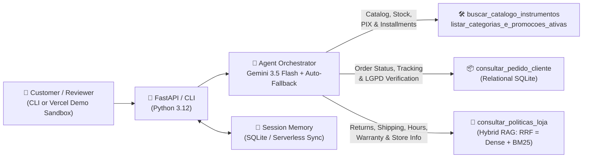
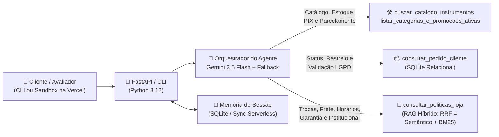

<a id="english-top"></a>

# 🎸 Empório da Música — Customer Support AI Agent (AI Engineer Case)

> 🇧🇷 **[Portuguese below / Versão em Português (PT-BR) abaixo ↓](#portuguese-below)**

Complete **Python Customer Support Conversational Agent** built for **Empório da Música** (a fictional musical instrument store in Campo Grande/MS, Brazil), developed for **Artefact's AI Engineer Technical Challenge**.

> 🧪 **Live Interactive Demo Sandbox (Bonus for Evaluation):** [**https://emporio-da-musica-agent-seven.vercel.app/**](https://emporio-da-musica-agent-seven.vercel.app/)
> *Hosted on Vercel strictly as an interactive evaluation sandbox so reviewers can test the agent immediately without local setup. The center panel simulates the customer messaging experience, while the side panels ("Quick Test Scenarios" and "Evaluator Mode — X-Ray") exist exclusively to expose real-time tool-calling telemetry during technical review.*

---

## ✨ Solution Overview

Empório da Música's human support team was overloaded with recurring inquiries regarding instrument availability, pricing, active promotions, payment/installment rules, order tracking, and return policies.

Following the challenge's core guideline (*"the focus is the agent working properly"* with **Python as the main language**), the heart of this project is a modular **Python Hybrid Agent with Function Calling**:
- **Structured operational data (`data/*.csv`)** is audited, cleaned, and queried deterministically via an **in-memory SQLite relational layer** in Python — eliminating hallucinations on prices, stock counts, PIX discounts, and installment calculations.
- **Store policies and procedures (`data/políticas_da_loja.pdf`)** are parsed into 26 section-aware chunks and indexed in a **Hybrid RAG engine** combining **Dense Embeddings (`gemini-embedding-2`)** and **BM25 Lexical Search** via *Reciprocal Rank Fusion (RRF)*.
- **Interaction Interfaces (CLI + Optional Web Demo Sandbox):** the agent runs natively in the terminal (`python cli.py`) and via `FastAPI`. As an extra convenience ("cherry on top") for reviewers, a lightweight web sandbox deployed on Vercel lets evaluators trigger test scenarios in one click and inspect underlying tool calls via **Evaluator Mode (X-Ray)** — a developer-only view that would never be shown to end customers in production.

---

## 🏛️ Architecture



### Project Structure

```text
emporio-da-musica/
├── api/
│   └── index.py               # FastAPI entrypoint (local + Vercel Serverless) & IP rate limiting
├── data/
│   ├── *.csv                  # Raw catalog, customers, orders, items, and promotions tables
│   ├── políticas_da_loja.pdf  # Official internal store policy manual (8 pages)
│   └── policies_index.json    # Versioned cache of 26 hierarchical chunks + 768d embeddings
├── examples/                  # 5 real multi-turn conversation transcripts with tool traces
├── public/                    # Lightweight demo sandbox UI (HTML/CSS/JS) with Evaluator X-Ray
├── scripts/
│   └── generate_examples.py   # Reproducible script to execute and export real test scenarios
├── src/
│   ├── config.py              # Environment config, paths, and model fallback chain
│   ├── database.py            # CSV sanitization, anomaly detection, and SQLite repository
│   ├── rag.py                 # Section-aware PDF parser + Hybrid Retriever (BM25 + Cosine RRF)
│   ├── tools.py               # Deterministic catalog, payment calculator, order/LGPD & RAG tools
│   ├── prompts.py             # System Prompt, musical store persona, and scope/LGPD guardrails
│   ├── memory.py              # SQLite session history persistence
│   └── agent.py               # Function-calling loop, tool trace telemetry, and model failover
├── tests/
│   └── test_emporio_agent.py  # 11 automated unit tests covering critical business rules
├── cli.py                     # Primary local interactive command-line interface (CLI)
├── pytest.ini                 # Pytest configuration
├── requirements.txt           # Lean production dependencies
├── requirements-dev.txt       # Development & testing dependencies
└── vercel.json                # Vercel Python Serverless bundling & timeout settings
```

---

## 🚀 Getting Started (Run Locally)

### Prerequisites
- **Python 3.11+**
- A free **Google AI Studio** API key: [https://aistudio.google.com/apikey](https://aistudio.google.com/apikey) *(no credit card required)*.

### 1. Clone the repository & create a virtual environment

```bash
git clone https://github.com/amandaveloso/emporio-da-musica-agent.git
cd emporio-da-musica-agent

# Windows (PowerShell)
python -m venv .venv
.\.venv\Scripts\Activate.ps1

# Linux / macOS
python3 -m venv .venv
source .venv/bin/activate
```

### 2. Install dependencies & configure `.env`

```bash
pip install -r requirements-dev.txt
cp .env.example .env
```

Edit `.env` and paste your free Gemini API key:

```env
GEMINI_API_KEY=your_google_ai_studio_key
GEMINI_MODEL=gemini-3.5-flash
```

### 3. Run via Terminal — CLI (Primary Local Mode)

```bash
python cli.py
```

### 4. Run the Simple Web Demo Sandbox Locally (Optional)

```bash
uvicorn api.index:app --reload --port 8000
```

Open **`http://localhost:8000`** in your browser to use the customer chat simulator alongside the optional **Evaluator Mode (X-Ray)**.

### 5. Run Automated Tests

```bash
pytest -v
```

---

## 🧠 Technical Decisions & Rationale

1. **Hybrid Tool-Calling Architecture (SQLite + RAG) vs. Alternatives:**
   - *Why not pure Vector RAG over CSVs?* Embedding tabular rows leads to unreliable numeric filtering (e.g., *"acoustic guitars under R$ 1,000"*), broken relational joins (`orders` ↔ `order_items` ↔ `products` ↔ `customers`), and missed boolean flags (`is_active = 1`).
   - *Why not unconstrained Text-to-SQL?* Allowing raw LLM-generated SQL risks join mistakes, forgotten business filters (such as offering `discontinued` items that still show residual stock), and accidental cross-customer data exposure.
   - *Chosen Design:* Typed Python tools wrap parameterized SQLite queries and exact financial calculations (PIX discounts, non-cumulativity, progressive installment minimums), while a dedicated Hybrid RAG tool handles unstructured normative policies from the PDF.
2. **Model Provider & Automatic Failover Chain:**
   - Powered by **Google Gemini (`gemini-3.5-flash`)** on the Google AI Studio Free Tier for strong Portuguese fluency, native function calling, and unified embeddings (`gemini-embedding-2`).
   - Free-tier endpoints can occasionally hit transient demand spikes (`HTTP 503` / `429`). `src/agent.py` implements short retry timeouts and automatic failover across `MODEL_FALLBACK_CHAIN` (`gemini-3.5-flash` → `gemini-3.5-flash-lite` → `gemini-3.8-flash`), with `thinking_budget=256` tuned for fast serverless response times (~2–4s).
3. **Section-Aware Chunking & Hybrid RRF Retrieval:**
   - Rather than naive fixed-character chunking that splits tables mid-sentence, `src/rag.py` strips headers/footers, stitches cross-page sections (e.g., *5.2 Shipping to Other Cities* across pages 4–5), and splits the manual into its **26 hierarchical sections**, preserving parent section titles.
   - Retrieval fuses **768-d Cosine Similarity** (pre-cached in `data/policies_index.json` for zero cold-start latency) with **Portuguese BM25** via **Reciprocal Rank Fusion (RRF)** — capturing both semantic intent (*"bought online and changed my mind"* → *4.1 Right of Regret*) and exact keywords (*"Jadlog"*, *"LGPD"*, *"CNPJ"*), with graceful fallback to pure BM25 if offline.
4. **Interaction Interface & Conversation Persistence:**
   - All agent intelligence lives in Python (`src/`) and runs standalone via `cli.py`. The Vercel web UI was added as a reviewer-friendly bonus, explicitly separating the **Customer Chat Simulator** from the **Evaluator X-Ray Inspector**.
   - Conversation history is persisted per `session_id` in **SQLite** (`sessions.db` locally; `/tmp` + recent client history sync on Vercel Serverless) to support natural multi-turn follow-ups.

---

## 🔍 Data Audit & Documented Assumptions

During exploratory analysis of `data/`, several real-world inconsistencies were uncovered and handled deterministically:

| Source | Finding | Engineering Decision / Handling |
| :--- | :--- | :--- |
| `promotions.csv` | Out of 25 promotions, **21 are expired (`is_active = 0`)** — including the 12% promo on *Takamine GD20* (`product_id = 95`) — and only **4 are active (`is_active = 1`)** (`90`, `94`, `121`, `127`). | `tools.py` applies discounts **strictly** when `is_active = 1`, while keeping expired promo history so the agent can transparently clarify past offers (Manual Sec. 7.3). |
| Manual Sec. 3 vs. 6.2 | PIX grants 5% off list price, but promotions are **non-cumulative** with the 5% PIX discount. | `calcular_condicoes_pagamento()` applies 5% PIX off only when `em_promocao_ativa = False`; active promos keep the promotional price and always display original price + % discount. |
| Manual Sec. 3 vs. 3.1 | Summary table mentions R\$ 100 min installment, whereas Sec. 3.1 specifies tiered minimums (up to 3x min R\$ 50; 4x–6x min R\$ 80; 7x–12x min R\$ 100). | Adopted the specific rule in **Section 3.1** to compute exact interest-free max installments per product. |
| `products.csv` (`id = 136`) | *Ibanez Bass 2X* has `stock_quantity = 13`, yet `status = discontinued`. | Availability logic ignores residual stock on `discontinued` items, labels them discontinued, and suggests active alternatives from the same category (Sec. 7.3). |
| `products.csv` (`id = 96`, `130`) | *Giannini GF-3D* is `active` with `stock_quantity = 0`; *Kala KA-ABP-CTG* is `coming_soon` (and referenced in orders `3` and `14`). | Excluded from in-stock listings; when queried directly, the tool reports exact status and suggests 3 similar in-stock instruments. |
| `products.csv` (`ids 135–144`) | Catalog mismatches across title, description, and JSON `specs` (e.g., `id = 135` named *Music Man* with *Fender Jazz Bass* description; `id = 142` *Korg* vs *Roland 88 keys* vs `specs` `61` keys). | `database.py` flags anomalies at ingestion (`data_quality_notes`) and instructs the agent to disclose discrepancies transparently and offer physical verification. |
| `categories.csv` (`ids 6, 7, 8`) | *Woodwinds*, *Brass*, and *Orchestral Strings* exist in `categories.csv` but have 0 rows in `products.csv`. | Reported with `disponiveis = 0` so the agent informs current digital catalog unavailability without hallucinating models. |
| `políticas_da_loja.pdf` | Cover/Sec. 1.2 list phone `(67) 3341-4444` and accented email (`contato@empóriodamusica.com.br`), while Sec. 7 lists WhatsApp `(67) 3321-4500`. | Standardized valid ASCII email (`contato@emporiodamusica.com.br`) and surfaced both official phone/WhatsApp channels clearly. |
| `orders.csv` + LGPD | Sequential `order_id`s (`1..20`) could leak personal customer data if queried blindly. | `consultar_pedido_cliente()` enforces LGPD holder verification (name, email, or phone digits) before returning order details and masks emails (Sec. 9). |

---

## 💬 Real Interaction Examples (`examples/`)

The [`examples/`](./examples/) folder contains **5 real multi-turn transcripts** generated by the agent (including collapsible tool-call telemetry):

1. [`01_catalogo_violoes_ate_1000.md`](./examples/01_catalogo_violoes_ate_1000.md) — Filtered search for acoustic guitars up to R\$ 1,000 + beginner nylon recommendation & PIX/installment breakdown.
2. [`02_takamine_gd20_promocao_expirada_e_loja.md`](./examples/02_takamine_gd20_promocao_expirada_e_loja.md) — *Takamine GD20* pricing handling an expired 12% promotion (`is_active = 0`) + store address & opening hours.
3. [`03_pedido_lgpd_e_direito_arrependimento.md`](./examples/03_pedido_lgpd_e_direito_arrependimento.md) — **Non-trivial scenario:** order `#8` tracking with LGPD identity verification + online Right of Regret rules (Sec. 4.1).
4. [`04_promocao_ativa_nao_cumulativa_e_sem_estoque.md`](./examples/04_promocao_ativa_nao_cumulativa_e_sem_estoque.md) — Active 18% promo non-cumulativity with PIX (*Crafter HT-100*) + out-of-stock handling with in-stock alternatives (*Giannini GF-3D*).
5. [`05_guardrails_acessorios_e_fora_de_escopo.md`](./examples/05_guardrails_acessorios_e_fora_de_escopo.md) — Polite redirection for standalone accessories (strings/picks/amps) and strict refusal of out-of-scope prompts.

---

## ⚠️ Known Limitations & What I Would Do With More Time

1. **Managed Cloud Session Persistence:** On Vercel Serverless, `/tmp` storage is ephemeral across cold starts (mitigated here via client-side recent history sync). In production, I would back sessions with **PostgreSQL (Supabase/Neon)** or **Redis (Upstash)**.
2. **Strong Customer Authentication:** Declarative name/email/phone matching prevents casual ID enumeration, whereas a production WhatsApp Business integration would verify the authenticated sender phone number or a one-time passcode (OTP).
3. **Automated LLM Evaluation Suite (Evals):** Beyond deterministic `pytest` unit tests, I would add an *LLM-as-a-Judge* evaluation pipeline measuring faithfulness, tool-selection recall, and persona adherence across synthetic adversarial dialogues.
4. **Live Carrier Shipping Quotes:** Direct integration with Correios and Jadlog APIs for real-time ZIP-code shipping quotes outside Greater Campo Grande.
5. **Token Streaming (SSE):** Server-Sent Events streaming on the web sandbox for lower perceived time-to-first-token.

---

## 🤖 Use of Coding Assistants (AI Workflow)

As requested in the challenge guidelines, **Google Antigravity** was used as an AI pair-programming assistant throughout development:

1. **Exploratory Data & Policy Auditing:** Used to rapidly cross-check all 6 CSV schemas against the 8-page PDF manual, surfacing edge cases (discontinued items with stock > 0, inactive promotions, catalog text mismatches, and tiered installment rules) which I reviewed and turned into explicit deterministic rules.
2. **Architecture-First Planning:** Collaborated on structuring a clean Python-first modular design separating relational queries (SQLite) from normative retrieval (Hybrid RAG), alongside a lightweight Vercel evaluation sandbox.
3. **Test-Driven Incremental Implementation:** Each module (`database`, `rag`, `tools`, `agent`, `api`, `ui`) was built and verified step by step with `pytest` and live Gemini calls — catching real integration nuances early, such as transient `HTTP 503` spikes (solved via model failover) and Vercel serverless bundling/routing behaviors.
4. **Documentation & Demo Polish:** Assisted in crafting the store-themed evaluation sandbox (with the *Evaluator X-Ray* inspector) and structuring this bilingual documentation.

---
---

<a id="portuguese-below"></a>

# 🇧🇷 Empório da Música — Assistente Virtual de Atendimento (Versão em Português — PT-BR)

> 🇺🇸 **[Back to English version ↑](#english-top)**

Protótipo completo de **Agente Conversacional de Atendimento ao Cliente** construído em **Python** para a **Empório da Música** (loja fictícia de instrumentos musicais em Campo Grande/MS), desenvolvido para o Desafio Técnico de AI Engineer da **Artefact**.

> 🧪 **Demonstração Interativa Online (Bônus para Avaliação):** [**https://emporio-da-musica-agent-seven.vercel.app/**](https://emporio-da-musica-agent-seven.vercel.app/)
> *Ambiente publicado na Vercel exclusivamente para facilitar o teste imediato pela banca avaliadora (inclui simulador do chat do cliente + modo opcional "Raio-X" para inspecionar as chamadas de ferramentas em tempo real).*

---

## ✨ Visão Geral da Solução

A equipe da Empório da Música recebia grande volume de dúvidas recorrentes sobre disponibilidade de instrumentos, preços, promoções, formas de pagamento, rastreamento de pedidos e regras de troca/devolução.

Para resolver esse problema com **precisão nos números** e **fidelidade às políticas internas**, o foco central deste projeto é o **motor do Agente em Python**, estruturado como um **Agente Híbrido com Function Calling**:
- **Dados operacionais estruturados (`data/*.csv`)** são higienizados, auditados e consultados de forma determinística via **SQLite em Python**, eliminando alucinações em preços, descontos, cálculos de PIX e regras de parcelamento.
- **Políticas e procedimentos (`data/políticas_da_loja.pdf`)** são indexados por seção hierárquica em um motor **RAG Híbrido** que combina **Embeddings Semânticos (`gemini-embedding-2`)** e **BM25 Léxico** via *Reciprocal Rank Fusion (RRF)*.
- **Interface de Interação (CLI + Sandbox Web de Demonstração):** o agente funciona integralmente via terminal (`python cli.py`) e API (`FastAPI`). Como complemento ("cereja do bolo") para facilitar a experiência da banca avaliadora, o projeto inclui uma **UI web simples publicada na Vercel** que atua como um **Sandbox de Demonstração Técnica**: a área central simula o canal de mensagens do cliente final (como o WhatsApp da loja), enquanto os painéis laterais (*Atalhos de Teste* e *Modo Avaliador / Raio-X*) foram criados **exclusivamente para inspeção técnica durante a avaliação do case** (ocultáveis em 1 clique e naturalmente inexistentes para o consumidor final em produção).

---

## 🏛️ Arquitetura



### Estrutura de Pastas

```text
emporio-da-musica/
├── api/
│   └── index.py               # Entrada FastAPI (local + Vercel Serverless) e rate limiting
├── data/
│   ├── *.csv                  # Tabelas originais de catálogo, clientes, pedidos e promoções
│   ├── políticas_da_loja.pdf  # Manual interno oficial da Empório da Música
│   └── policies_index.json    # Cache versionado dos chunks hierárquicos + embeddings (768d)
├── examples/                  # 5 transcrições reais multi-turno com telemetria de tools
├── public/                    # Interface web leve de demonstração (HTML/CSS/JS) com Raio-X
├── scripts/
│   └── generate_examples.py   # Script reprodutível que executa e exporta os cenários de teste
├── src/
│   ├── config.py              # Variáveis de ambiente, caminhos e cadeia de fallback
│   ├── database.py            # Limpeza dos CSVs, auditoria de anomalias e banco SQLite
│   ├── rag.py                 # Extrator de PDF sensível a seções + busca híbrida (BM25 + Cosseno)
│   ├── tools.py               # Ferramentas determinísticas de catálogo, pagamento, pedidos e RAG
│   ├── prompts.py             # System Prompt, persona musical e guardrails de escopo/LGPD
│   ├── memory.py              # Persistência de histórico de conversa por sessão
│   └── agent.py               # Loop de Function Calling, rastreabilidade de tools e resiliência
├── tests/
│   └── test_emporio_agent.py  # 11 testes automatizados cobrindo regras críticas de negócio
├── cli.py                     # Interface interativa de linha de comando (modo principal local)
├── pytest.ini                 # Configuração do pytest
├── requirements.txt           # Dependências enxutas de produção
├── requirements-dev.txt       # Dependências de desenvolvimento e testes (pytest)
└── vercel.json                # Configuração de empacotamento e função Python na Vercel
```

---

## 🚀 Como Rodar o Projeto Localmente

### Pré-requisitos
- **Python 3.11+**
- Uma chave de API gratuita do **Google AI Studio**: [https://aistudio.google.com/apikey](https://aistudio.google.com/apikey) *(não exige cartão de crédito)*.

### 1. Clonar o repositório e criar o ambiente virtual

```bash
git clone https://github.com/amandaveloso/emporio-da-musica-agent.git
cd emporio-da-musica-agent

# Windows (PowerShell)
python -m venv .venv
.\.venv\Scripts\Activate.ps1

# Linux / macOS
python3 -m venv .venv
source .venv/bin/activate
```

### 2. Instalar as dependências e configurar o `.env`

```bash
pip install -r requirements-dev.txt
cp .env.example .env
```

Abra o arquivo `.env` e insira sua chave gratuita:

```env
GEMINI_API_KEY=sua_chave_do_google_ai_studio
GEMINI_MODEL=gemini-3.5-flash
```

### 3. Executar via Terminal — CLI (Modo Principal Local)

Para testar diretamente o motor do agente em Python pelo terminal:

```bash
python cli.py
```

### 4. Executar o Sandbox Web Simples (Opcional / Mesmo Ambiente da Vercel)

```bash
uvicorn api.index:app --reload --port 8000
```

Acesse **`http://localhost:8000`** no navegador para testar o simulador de chat do cliente com o modo opcional de inspeção para avaliadores (*Modo Avaliador — Raio-X*).

### 5. Executar a Suíte de Testes Automatizados

```bash
pytest -v
```

---

## 🧠 Justificativa das Decisões Técnicas

### 1. Abordagem Híbrida (Function Calling + SQLite + RAG) vs. Alternativas
- **Por que não usar RAG puro sobre os CSVs?** Buscas vetoriais em tabelas falham em filtros numéricos exatos (como *"violões até R$ 1.000"*), somas, cruzamentos relacionais (`orders` ↔ `order_items` ↔ `products` ↔ `customers`) e verificações booleanas estritas (`is_active = 1`).
- **Por que não usar um SQL Agent livre (Text-to-SQL)?** Permitir que o LLM gere SQL arbitrário introduz risco de erros de sintaxe/join, esquecimento de filtros de negócio (como ignorar itens `discontinued` com saldo em estoque) e exposição acidental de dados pessoais de outros clientes.
- **Solução escolhida:** Ferramentas Python tipadas que encapsulam consultas SQL parametrizadas e cálculos financeiros determinísticos, combinadas a uma ferramenta de **RAG Híbrido** dedicada ao manual em PDF. O LLM atua onde é mais forte: compreensão de intenção, seleção/combinação de ferramentas e síntese empática na persona da loja.

### 2. Modelo, Provedor e Resiliência (Fallback Automático)
- **Provedor:** **Google Gemini API** (Free Tier via Google AI Studio), escolhida por oferecer excelente desempenho em português, *Function Calling* nativo confiável e modelo de *embeddings* na mesma credencial gratuita.
- **Cadeia de Fallback (`MODEL_FALLBACK_CHAIN`):** APIs gratuitas podem sofrer picos momentâneos de demanda (`HTTP 503` / `429`). O orquestrador em `src/agent.py` configura *timeouts* curtos e realiza *failover* automático de `gemini-3.5-flash` para `gemini-3.5-flash-lite` (e `gemini-3.8-flash`), evitando travamentos durante testes. Além disso, o `thinking_budget` foi calibrado em `256` tokens para equilibrar raciocínio de seleção de *tools* com latência responsiva (~2 a 4s).

### 3. Arquitetura de Retrieval (RAG Sensível a Seções + Fusão Híbrida RRF)
- **Chunking Hierárquico:** Em vez de recortes fixos de caracteres que quebram tabelas ao meio, `src/rag.py` higieniza cabeçalhos/rodapés, concatena quebras de página (preservando seções que atravessam páginas, como *5.2 Entregas para Outras Cidades* e *7.2 Fluxo de Atendimento*) e segmenta o manual nas suas **26 seções e subseções oficiais** (`1.` a `10.`), mantendo o título da seção-pai em cada *chunk*.
- **Busca Híbrida (Semântica + BM25):** Combina similaridade de cosseno em vetores de 768 dimensões (`gemini-embedding-2`, pré-indexados em `data/policies_index.json` para eliminar custo de *cold start*) com pontuação léxica **BM25** em português via **Reciprocal Rank Fusion (RRF)**. Assim, buscas conceituais (*"comprei online e não curti"*) encontram *4.1 Direito de Arrependimento*, enquanto termos exatos (*"Jadlog"*, *"LGPD"*, *"CNPJ"*) mantêm precisão máxima. Caso a API de embeddings esteja indisponível, o sistema degrada graciosamente para BM25 puro sem interromper o atendimento.

### 4. Interface de Interação e Persistência do Histórico
- **Prioridade no Agente + Conveniência para Avaliação:** Seguindo a orientação do desafio (*"o foco é o agente funcionando corretamente"*), toda a inteligência de negócio, higienização, busca híbrida e orquestração foi concentrada nos módulos Python (`src/`) e exposta via CLI (`cli.py`). A interface web simples servida na Vercel foi pensada como um **extra de usabilidade para a avaliação**: permite testar o agente imediatamente sem precisar configurar chaves locais e separa claramente o **Simulador de Chat do Cliente** do **Modo Avaliador (Raio-X)** — este último criado apenas para dar visibilidade às decisões internas de *Function Calling* durante a revisão técnica, não fazendo parte da visão de um usuário final real.
- **Memória de Conversa:** Implementada em `src/memory.py` com **SQLite** (`sessions.db` localmente e `/tmp/emporio_sessions.db` em ambiente serverless), complementada por sincronização do histórico recente a partir do navegador (`localStorage`). Isso garante continuidade natural em perguntas de acompanhamento (*"e como fica ele no PIX?"*, *"meu nome é Ana Carolina"*) mesmo entre recarregamentos ou reciclagem de instâncias serverless.

---

## 🔍 Auditoria de Dados e Suposições Documentadas

Durante a exploração dos arquivos em `data/`, foram identificadas inconsistências reais (provavelmente inseridas para avaliar rigor analítico). Abaixo estão os achados e como o sistema os trata automaticamente:

| Fonte | Situação Encontrada | Decisão / Tratamento Implementado |
| :--- | :--- | :--- |
| `promotions.csv` | De 25 promoções cadastradas, **21 estão expiradas (`is_active = 0`)** — incluindo a de 12% do *Takamine GD20* (`product_id = 95`) — e apenas **4 estão ativas (`is_active = 1`)** (`90`, `94`, `121`, `127`). | `tools.py` aplica descontos **exclusivamente** quando `is_active = 1`, mas preserva o histórico expirado para explicar com transparência caso o cliente mencione uma oferta antiga (Seção 7.3). |
| Manual Seção 3 vs. 6.2 | PIX concede 5% de desconto à vista, porém promoções **não são cumulativas** com o desconto de PIX. | `calcular_condicoes_pagamento()` aplica 5% no PIX apenas quando `em_promocao_ativa = False`; em itens promocionais, mantém o valor promocional e exibe preço original + % de desconto. |
| Manual Seção 3 vs. 3.1 | A tabela geral cita parcela mínima de R\$ 100,00, enquanto o item 3.1 detalha escada progressiva (até 3x mín. R\$ 50; 4x–6x mín. R\$ 80; 7x–12x mín. R\$ 100). | Adotada a regra específica da **Seção 3.1** para calcular o número máximo exato de parcelas sem juros de cada instrumento. |
| `products.csv` (`id = 136`) | O baixo *Ibanez Bass 2X* possui `stock_quantity = 13`, mas `status = discontinued`. | Filtro de estoque ignora saldo residual de itens `discontinued`, classifica como `descontinuado` e sugere alternativas ativas da mesma categoria (Seção 7.3). |
| `products.csv` (`id = 96`, `130`) | *Giannini GF-3D* está `active` com `stock_quantity = 0`; *Kala KA-ABP-CTG* está `coming_soon` (e aparece nos pedidos `3` e `14`). | Excluídos das listagens de pronta entrega; quando buscados diretamente, informam status exato e retornam 3 alternativas similares disponíveis. |
| `products.csv` (`ids 135–144`) | Divergências cadastrais entre título, descrição e JSON `specs` (ex.: `id = 135` *Music Man* com descrição *Fender Jazz Bass*; `id = 142` *Korg* com descrição *Roland 88 teclas* e `specs` `61` teclas). | `database.py` detecta essas anomalias na carga (`data_quality_notes`) e instrui o agente a sinalizar a divergência com transparência, recomendando confirmação física com a equipe. |
| `categories.csv` (`ids 6, 7, 8`) | As categorias *Sopro (Madeiras)*, *Sopro (Metais)* e *Cordas Orquestrais* existem em `categories.csv`, mas têm 0 produtos em `products.csv`. | Mapeadas em `listar_categorias_e_promocoes_ativas()` com `disponiveis = 0` para que o agente informe indisponibilidade atual no catálogo digital sem inventar itens. |
| `políticas_da_loja.pdf` | Capa/Seção 1.2 informam `(67) 3341-4444` e e-mail com acento na tabela 1.2 (`contato@empóriodamusica.com.br`), enquanto a Seção 7 informa WhatsApp `(67) 3321-4500`. | Padronizado e-mail válido sem acento (`contato@emporiodamusica.com.br`) e apresentação transparente de ambos os números (central `(67) 3341-4444` e WhatsApp dedicado `(67) 3321-4500`). |
| `orders.csv` + LGPD | Consulta livre por `order_id` sequencial (`1..20`) poderia expor dados pessoais e compras de terceiros. | `consultar_pedido_cliente()` exige confirmação de nome, e-mail ou final do telefone do titular antes de liberar detalhes do pedido e mascara o e-mail no retorno (Seção 9 - LGPD). |

---

## 💬 Exemplos Reais de Interação (`examples/`)

A pasta [`examples/`](./examples/) contém **5 conversas multi-turno reais** geradas pelo agente (incluindo os registros das *tools* chamadas e latências):

1. [`01_catalogo_violoes_ate_1000.md`](./examples/01_catalogo_violoes_ate_1000.md) — Busca filtrada de violões até R\$ 1.000 + recomendação para iniciante em nylon com simulação PIX/cartão.
2. [`02_takamine_gd20_promocao_expirada_e_loja.md`](./examples/02_takamine_gd20_promocao_expirada_e_loja.md) — Consulta de preço do Takamine GD20 tratando promoção expirada (`is_active = 0`) + endereço e horário da loja.
3. [`03_pedido_lgpd_e_direito_arrependimento.md`](./examples/03_pedido_lgpd_e_direito_arrependimento.md) — **Cenário não trivial:** rastreamento do pedido `#8` com verificação de titularidade LGPD + aplicação das regras de Direito de Arrependimento (Seção 4.1).
4. [`04_promocao_ativa_nao_cumulativa_e_sem_estoque.md`](./examples/04_promocao_ativa_nao_cumulativa_e_sem_estoque.md) — Promoção ativa não cumulativa com PIX (*Crafter HT-100*) + tratamento de item sem estoque com sugestão de alternativas (*Giannini GF-3D*).
5. [`05_guardrails_acessorios_e_fora_de_escopo.md`](./examples/05_guardrails_acessorios_e_fora_de_escopo.md) — Recusa educada de acessórios avulsos (cordas/palhetas/amplificador) e bloqueio de solicitações fora do escopo da loja.

---

## ⚠️ Limitações Conhecidas e Próximos Passos (Com Mais Tempo)

1. **Persistência Distribuída em Produção:** Na Vercel Serverless, o armazenamento `/tmp` é efêmero entre instâncias frias (mitigado aqui via sincronização do histórico recente pelo frontend). Em produção real, migraria o estado de sessão para **PostgreSQL (Supabase/Neon)** ou **Redis (Upstash)**.
2. **Autenticação Forte para Pedidos:** A confirmação atual de titularidade (nome/e-mail/telefone) previne enumeração casual de IDs, mas em produção via WhatsApp Business API integraria validação pelo número autenticado do remetente ou código OTP.
3. **Avaliação Automatizada de Respostas (Evals):** Além dos testes determinísticos de regras de negócio (`pytest`), implementaria um pipeline de *LLM-as-a-Judge* medindo *faithfulness*, *tool selection accuracy* e aderência de tom em dezenas de diálogos sintéticos.
4. **Cálculo de Frete em Tempo Real:** Integração com APIs de frete (Correios/Jadlog) por CEP para cotações automáticas fora da Região Metropolitana de Campo Grande.
5. **Streaming de Respostas (SSE):** Envio progressivo de tokens na interface web para reduzir a percepção de latência em respostas mais longas.

---

## 🤖 Uso de Assistentes de Código (Workflow com IA)

Conforme solicitado nas instruções do desafio, este projeto contou com o uso do **Google Antigravity** como assistente de programação em par (*AI pair programming*). Meu fluxo de trabalho foi estruturado nas seguintes etapas:

1. **Análise Exploratória e Descoberta de Casos de Borda:** Utilizei o assistente para inspecionar rapidamente a estrutura relacional dos 6 arquivos CSV e as 8 páginas do manual em PDF, levantando hipóteses de inconsistências cadastrais (como produtos descontinuados com estoque positivo, promoções inativas e regras conflitantes de parcelamento) que revisei e transformei em requisitos de negócio explícitos.
2. **Desenho de Arquitetura Antes do Código:** Definimos em conjunto um plano em etapas priorizando Python como linguagem central, separação clara entre dados tabulares (SQLite) e texto normativo (RAG híbrido), e compatibilidade gratuita com deploy serverless na Vercel.
3. **Desenvolvimento Incremental Orientado a Testes:** Cada módulo (`database`, `rag`, `tools`, `agent`, `api`, `ui`) foi implementado e validado individualmente com testes unitários (`pytest`) e chamadas reais à API do Gemini — o que permitiu detectar e corrigir cedo comportamentos reais, como picos `HTTP 503` em modelos específicos (resolvido com cadeia de *fallback*) e particularidades de empacotamento/roteamento serverless na Vercel.
4. **Documentação e Identidade Visual:** Apoio na construção do sandbox web temático da Empório da Música (incluindo o inspetor *Modo Avaliador — Raio-X* para facilitar a avaliação técnica) e na consolidação desta documentação bilíngue.
