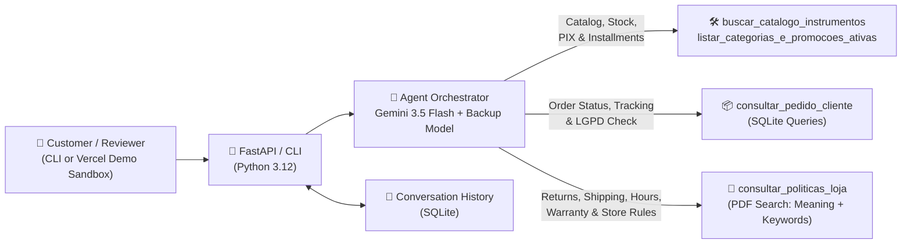
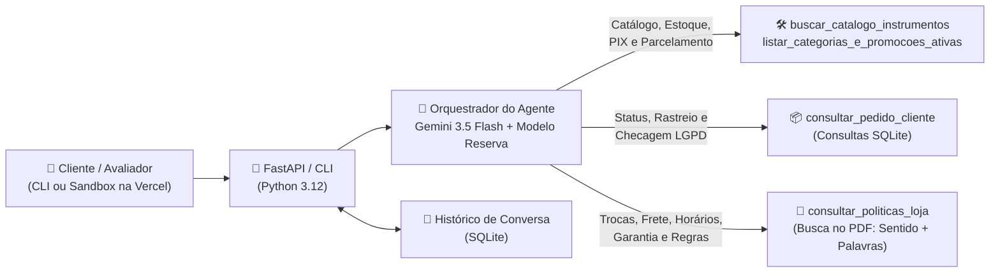

<a id="english-top"></a>

# 🎸 Empório da Música — Customer Support AI Agent (AI Engineer Case)

> 🇧🇷 **[Portuguese below / Versão em Português (PT-BR) abaixo ↓](#portuguese-below)**

Complete **Python Customer Support Conversational Agent** built for **Empório da Música** (a fictional musical instrument store in Campo Grande/MS, Brazil), developed for **Artefact's AI Engineer Technical Challenge**.

> 🧪 **Live Interactive Demo Sandbox (Bonus for Evaluation):** [**https://emporio-da-musica-agent-seven.vercel.app/**](https://emporio-da-musica-agent-seven.vercel.app/)
> *Published on Vercel strictly as a testing environment so reviewers can try the agent immediately without setting up keys locally. The center chat simulates the customer experience, while the side panels ("Quick Test Scenarios" and "Evaluator Mode — X-Ray") exist only for technical inspection during review — not for end customers.*

---

## ✨ Solution Overview

Empório da Música's support team was overloaded with repetitive questions about instrument availability, prices, active promotions, payment/installment rules, order status, and return policies.

Following the challenge's main guideline (*"the focus is the agent working properly"* with **Python as the main language**), I structured the solution around separating **exact tabular data** from **text policies**:
- **Structured store data (`data/*.csv`)** is cleaned, validated, and queried using **SQLite in Python** — ensuring prices, stock counts, PIX discounts, and installment rules are calculated with exact code rather than guessed by the language model.
- **Store policies (`data/políticas_da_loja.pdf`)** are split by the manual's numbered sections and searched using a **RAG module** that combines **search by meaning** (Gemini embeddings) with **exact keyword search** — so the agent finds the right rule whether the customer uses informal phrasing or exact terms.
- **Simple Interfaces (CLI + Optional Web Demo Sandbox):** the agent runs directly in the terminal (`python cli.py`) and via `FastAPI`. As a "cherry on top" to make evaluation easier, I added a simple web sandbox on Vercel where reviewers can test scenarios in one click and optionally inspect which Python tools the agent called (**Evaluator Mode — X-Ray**).

---

## 🏛️ Architecture



### Project Structure

```text
emporio-da-musica/
├── api/
│   └── index.py               # FastAPI entrypoint (local + Vercel) & simple IP rate limit
├── data/
│   ├── *.csv                  # Raw catalog, customers, orders, items, and promotions tables
│   ├── políticas_da_loja.pdf  # Official internal store policy manual (8 pages)
│   └── policies_index.json    # Saved PDF sections + embeddings so startup is fast
├── examples/                  # 5 real multi-turn conversation logs generated by the agent
├── public/                    # Simple web demo sandbox (HTML/CSS/JS) with Evaluator X-Ray
├── scripts/
│   └── generate_examples.py   # Script to run and export real test conversations
├── src/
│   ├── config.py              # Environment variables, paths, and backup model list
│   ├── database.py            # CSV cleaning, data quality checks, and SQLite loader
│   ├── rag.py                 # PDF section splitter + policy search (meaning + keywords)
│   ├── tools.py               # Python functions for catalog, payment math, orders & policies
│   ├── prompts.py             # System instructions, store tone of voice, and scope limits
│   ├── memory.py              # SQLite conversation history per session
│   └── agent.py               # Main loop connecting Gemini to the Python tools
├── tests/
│   └── test_emporio_agent.py  # 11 automated tests checking core business rules
├── cli.py                     # Terminal chat interface (primary local mode)
├── pytest.ini                 # Pytest configuration
├── requirements.txt           # Production dependencies
├── requirements-dev.txt       # Development & testing dependencies
└── vercel.json                # Vercel deployment configuration
```

---

## 🚀 Getting Started (Run Locally)

### Prerequisites
- **Python 3.11+**
- A free **Google AI Studio** API key: [https://aistudio.google.com/apikey](https://aistudio.google.com/apikey) *(no credit card required)*.

### 1. Clone the repository & create a virtual environment

```bash
git clone https://github.com/amandaveloso/emporio-da-musica-agent.git
cd emporio-da-musica-agent

# Windows (PowerShell)
python -m venv .venv
.\.venv\Scripts\Activate.ps1

# Linux / macOS
python3 -m venv .venv
source .venv/bin/activate
```

### 2. Install dependencies & configure `.env`

```bash
pip install -r requirements-dev.txt
cp .env.example .env
```

Open `.env` and add your free Gemini API key:

```env
GEMINI_API_KEY=your_google_ai_studio_key
GEMINI_MODEL=gemini-3.5-flash
```

### 3. Run via Terminal — CLI (Primary Local Mode)

```bash
python cli.py
```

### 4. Run the Web Demo Sandbox Locally (Optional)

```bash
uvicorn api.index:app --reload --port 8000
```

Open **`http://localhost:8000`** in your browser to test the customer chat simulator and the optional **Evaluator Mode (X-Ray)**.

### 5. Run Automated Tests

```bash
pytest -v
```

---

## 🧠 Technical Decisions & Rationale

1. **Separating Tabular Queries (SQLite) from Document Search (RAG):**
   - Coming from a Data background, my main priority was avoiding numeric errors or invented rules. Searching CSV tables purely as text makes filters like *"acoustic guitars up to R\$ 1,000"*, table joins (`orders` ↔ `order_items` ↔ `products` ↔ `customers`), and active flags (`is_active = 1`) unreliable.
   - At the same time, letting an LLM write free-form SQL directly on the database could forget business rules (such as ignoring `discontinued` items that still have stock) or expose another customer's order.
   - **Chosen approach:** Controlled Python functions (`tools.py`) run parameterized SQLite queries and exact payment math, while a separate RAG tool searches the PDF manual for store policies. The LLM focuses on understanding the customer's question, calling the right Python function(s), and writing a clear, friendly answer.
2. **LLM Provider & Automatic Backup Model:**
   - I chose **Google Gemini (`gemini-3.5-flash`)** via Google AI Studio's free tier because it handles Portuguese naturally, supports native *Function Calling* (choosing which Python tool to run), and provides embeddings under the same free API key.
   - During real testing, we saw free-tier models occasionally return temporary `HTTP 503` (high demand) errors. To keep the agent reliable, `src/agent.py` automatically falls back to `gemini-3.5-flash-lite` (and `gemini-3.8-flash`) if the primary model is busy.
3. **PDF Policy Search (`src/rag.py`):**
   - Instead of cutting the 8-page PDF every fixed number of characters (which would cut pricing/shipping tables in half), the parser splits the document along its **26 numbered sections** (`1.`, `1.1`, ..., `10.`), keeping the section title attached to each block of text.
   - To retrieve the best sections for a question, it combines **search by meaning** (Gemini embeddings, useful when a customer says *"bought online and changed my mind"* without knowing the term *"Right of Regret"*) and **exact keyword matching** (BM25, useful for specific terms like *"Jadlog"*, *"LGPD"*, or *"CNPJ"*). The pre-processed sections are saved in `data/policies_index.json` so the app starts quickly without re-indexing the PDF every time.
4. **Interaction Interface & Conversation Memory:**
   - All business logic lives in Python (`src/`) and works directly in the terminal (`cli.py`). The Vercel web page was built as a bonus sandbox to facilitate testing, clearly separating the **Customer Chat Simulator** from the **Evaluator X-Ray** panel.
   - Conversation history is saved per session in **SQLite** (`sessions.db` locally, or `/tmp` synced with recent browser messages on Vercel) so follow-up questions (*"and how much is it via PIX?"*) keep context.

---

## 🔍 Exploratory Data Analysis & Documented Assumptions

Inspecting the raw CSVs and cross-checking them against the PDF manual revealed several data quality issues and edge cases. Below is how each one was handled:

| Source | Finding in the Data | Decision / How the Code Handles It |
| :--- | :--- | :--- |
| `promotions.csv` | Out of 25 rows, **21 promotions are expired (`is_active = 0`)** — including the 12% promo on *Takamine GD20* (`product_id = 95`) — and only **4 are active (`is_active = 1`)** (`90`, `94`, `121`, `127`). | `tools.py` applies discounts **only** when `is_active = 1`, while keeping the expired info so the agent can politely clarify if a customer asks about an old offer (Manual Sec. 7.3). |
| Manual Sec. 3 vs. 6.2 | PIX gives 5% off, but active promotions **cannot be combined** with the 5% PIX discount. | `calcular_condicoes_pagamento()` applies 5% PIX off only when there is no active promotion; promotional items keep the promo price and always show original price + % discount. |
| Manual Sec. 3 vs. 3.1 | The summary table mentions a R\$ 100 minimum installment, while Sec. 3.1 defines progressive minimums (up to 3x min R\$ 50; 4x–6x min R\$ 80; 7x–12x min R\$ 100). | Adopted the detailed rule in **Section 3.1** to calculate exact interest-free installments per instrument. |
| `products.csv` (`id = 136`) | *Ibanez Bass 2X* has `stock_quantity = 13`, but `status = discontinued`. | Filtering only by `stock > 0` would sell a discontinued product. The tool marks `discontinued` items as unavailable and suggests active alternatives in the same category. |
| `products.csv` (`id = 96`, `130`) | *Giannini GF-3D* is `active` with `stock_quantity = 0`; *Kala KA-ABP-CTG* has status `coming_soon` (and appears in orders `3` and `14`). | Excluded from in-stock searches; if asked directly, the agent informs the exact status and suggests 3 similar in-stock instruments. |
| `products.csv` (`ids 135–144`) | Catalog inconsistencies between title, description, and JSON `specs` (e.g., `id = 135` named *Music Man* with a *Fender Jazz Bass* description; `id = 142` *Korg* vs *Roland 88 keys* vs `specs` `61` keys). | `database.py` flags these mismatches when loading the CSV (`data_quality_notes`) so the agent warns the customer transparently and offers confirmation with the store team. |
| `categories.csv` (`ids 6, 7, 8`) | *Woodwinds*, *Brass*, and *Orchestral Strings* exist in `categories.csv` but have 0 products in `products.csv`. | Reported with `disponiveis = 0` so the agent informs they are currently unavailable in the catalog without inventing products. |
| `políticas_da_loja.pdf` | Cover/Sec. 1.2 show phone `(67) 3341-4444` and an accented email (`contato@empóriodamusica.com.br`), while Sec. 7 shows WhatsApp `(67) 3321-4500`. | Standardized the valid email without accent (`contato@emporiodamusica.com.br`) and presented both official phone/WhatsApp numbers clearly. |
| `orders.csv` + LGPD | Sequential `order_id`s (`1..20`) would expose personal data if anyone typed a random order number. | `consultar_pedido_cliente()` asks for simple holder confirmation (name, email, or phone digits) before showing order details, and partially masks the email (Sec. 9 - LGPD). |

---

## 💬 Real Interaction Examples (`examples/`)

The [`examples/`](./examples/) folder contains **5 real multi-turn conversations** tested with the agent (including which tools were called):

1. [`01_catalogo_violoes_ate_1000.md`](./examples/01_catalogo_violoes_ate_1000.md) — Search for acoustic guitars up to R\$ 1,000 + beginner nylon recommendation & PIX/installment simulation.
2. [`02_takamine_gd20_promocao_expirada_e_loja.md`](./examples/02_takamine_gd20_promocao_expirada_e_loja.md) — *Takamine GD20* price check handling an expired 12% promotion (`is_active = 0`) + store address & hours.
3. [`03_pedido_lgpd_e_direito_arrependimento.md`](./examples/03_pedido_lgpd_e_direito_arrependimento.md) — **Multi-step scenario:** order `#8` tracking with LGPD confirmation + online Right of Regret rules (Sec. 4.1).
4. [`04_promocao_ativa_nao_cumulativa_e_sem_estoque.md`](./examples/04_promocao_ativa_nao_cumulativa_e_sem_estoque.md) — Active 18% promo non-cumulativity with PIX (*Crafter HT-100*) + out-of-stock handling with in-stock alternatives (*Giannini GF-3D*).
5. [`05_guardrails_acessorios_e_fora_de_escopo.md`](./examples/05_guardrails_acessorios_e_fora_de_escopo.md) — Polite refusal of standalone accessories (strings/picks/amps) and out-of-scope questions.

---

## ⚠️ Known Limitations & Next Steps (With More Time)

1. **Cloud Database for Session History:** Locally, SQLite persists conversations on disk (`sessions.db`). On Vercel, serverless functions use temporary `/tmp` storage that resets when instances restart (handled here by sending recent browser history along with requests). In a production environment, I would connect a cloud database such as **PostgreSQL**.
2. **Stronger Customer Verification:** Checking name, email, or phone digits prevents someone from guessing sequential order IDs (`#1`, `#2`...), but in a real WhatsApp Business integration I would tie order lookups to the customer's authenticated phone number or a confirmation code.
3. **Recurring Quality Checks on Conversations:** Today, `pytest` covers the deterministic Python/SQL rules (discounts, installments, stock filters, LGPD, and policy lookup). With more time, I would build a broader test battery of common and tricky customer questions to track answer quality whenever prompts or models are updated.
4. **Shipping Quotes by ZIP Code (CEP):** Today the agent informs the official shipping rules and deadlines from the PDF; a natural evolution would be integrating carrier tables/APIs (Correios and Jadlog) to calculate shipping costs by CEP.

---

## 🤖 Use of Coding Assistants & Validation Workflow

With **4+ years of experience working with Data**, this challenge was my **first practical end-to-end project building an LLM conversational agent**. As encouraged in the guidelines, I used **Google Antigravity** as an AI coding assistant to help bridge the parts that were newer to me (Gemini Function Calling syntax, hybrid PDF search implementation, and Vercel serverless setup), while applying my data background to drive business rules, data quality, and validation at every step:

1. **Planning & Scope Control Before Coding:** Rather than asking the assistant to generate a black-box project all at once, I started by asking for a structured breakdown of the challenge and reviewed the plan first. I also steered scope decisions along the way — for example, making sure the Vercel interface was clearly framed as a **demo sandbox for evaluators** (separating the technical *Evaluator X-Ray* from the customer chat), keeping true to the prompt's focus on a working Python agent and a simple UI.
2. **Data-Driven Validation of Rules & Edge Cases:** I leaned on my experience with data analysis and SQL to review what was found in the 6 CSV files against the 8-page PDF manual — ensuring the code strictly filtered `is_active = 1` on promotions, blocked `discontinued` items even when `stock_quantity > 0`, flagged conflicting product descriptions/JSON specs, calculated PIX/installments accurately, and protected customer order data (LGPD).
3. **Hands-On Testing & Fixing Real Deployment Issues:** Nothing suggested by the AI assistant was treated as finished without running and testing it:
   - I ran the FastAPI server manually in my local terminal (`uvicorn`) and tested live conversations with my Gemini API key.
   - We verified the business logic with 11 automated tests (`pytest`) and noticed real free-tier API behavior (occasional `503` busy responses), validating the model fallback mechanism.
   - When deploying to Vercel, the first attempts failed in production (`FUNCTION_INVOCATION_FAILED` and `404` on `/api/chat`). By checking the deployment behavior, we identified that Vercel was reading `pyproject.toml` instead of installing `requirements.txt`, and that an extra rewrite rule in `vercel.json` was breaking FastAPI routes — both of which were fixed and re-tested live on the public URL.
4. **Reviewing Documentation for Clarity:** Finally, I reviewed both the real conversation transcripts in `examples/` and this `README.md` to make sure every architectural decision is documented clearly, honestly, and matches what I validated in practice.

---
---

<a id="portuguese-below"></a>

# 🇧🇷 Empório da Música — Assistente Virtual de Atendimento (Versão em Português — PT-BR)

> 🇺🇸 **[Back to English version ↑](#english-top)**

Protótipo de **Agente Conversacional de Atendimento ao Cliente** construído em **Python** para a **Empório da Música** (loja fictícia de instrumentos musicais em Campo Grande/MS), desenvolvido para o Desafio Técnico de AI Engineer da **Artefact**.

> 🧪 **Demonstração Interativa Online (Bônus para Avaliação):** [**https://emporio-da-musica-agent-seven.vercel.app/**](https://emporio-da-musica-agent-seven.vercel.app/)
> *Site publicado na Vercel exclusivamente como ambiente de demonstração do case para facilitar o teste imediato pela banca avaliadora. O painel central simula o chat que um cliente usaria, enquanto os painéis laterais ("Atalhos de Teste" e "Modo Avaliador — Raio-X") existem apenas para mostrar quais ferramentas o agente acionou por trás dos panos — algo que um cliente real não veria.*

---

## ✨ Visão Geral da Solução

A equipe da Empório da Música recebia muitas dúvidas repetidas sobre disponibilidade de instrumentos, preços, promoções, formas de pagamento, rastreamento de pedidos e regras de troca/devolução.

Seguindo a orientação principal do desafio (*"o foco é o agente funcionando corretamente"* e **Python como linguagem principal**), estruturei a solução separando o que é **consulta exata em tabelas** do que é **consulta de regras em texto**:
- **Dados estruturados (`data/*.csv`)** passam por limpeza e validação e são consultados via **SQLite em Python** — garantindo que preços, estoque, descontos de PIX e cálculos de parcelas venham de código exato, sem depender do modelo "tentar calcular de cabeça".
- **Políticas da loja (`data/políticas_da_loja.pdf`)** foram separadas pelas seções numeradas do manual e indexadas em um módulo de **RAG** que combina **busca por sentido** (embeddings do Gemini) com **busca por palavras exatas** — permitindo achar a regra certa tanto quando o cliente fala de forma informal quanto quando cita um termo específico.
- **Interface Simples (CLI + Sandbox Web na Vercel):** o agente roda direto pelo terminal (`python cli.py`) e via `FastAPI`. Como uma "cereja do bolo" para facilitar a avaliação, publiquei também uma interface web simples na Vercel que permite testar cenários com 1 clique e acompanhar as ferramentas acionadas pelo agente no **Modo Avaliador (Raio-X)**.

---

## 🏛️ Arquitetura



### Estrutura de Pastas

```text
emporio-da-musica/
├── api/
│   └── index.py               # Entrada da API FastAPI (local + Vercel) e limite simples por IP
├── data/
│   ├── *.csv                  # Tabelas originais de catálogo, clientes, pedidos e promoções
│   ├── políticas_da_loja.pdf  # Manual interno oficial da Empório da Música (8 páginas)
│   └── policies_index.json    # Seções do PDF + vetores salvos para iniciar rápido
├── examples/                  # 5 conversas reais geradas e testadas no agente
├── public/                    # Interface web simples de demonstração (HTML/CSS/JS) com Raio-X
├── scripts/
│   └── generate_examples.py   # Script para rodar e exportar os cenários reais de conversa
├── src/
│   ├── config.py              # Configurações, caminhos e lista de modelos reserva
│   ├── database.py            # Limpeza dos CSVs, checagem de qualidade e carga no SQLite
│   ├── rag.py                 # Divisão do PDF por seções + busca combinada (sentido + palavras)
│   ├── tools.py               # Funções Python de catálogo, cálculo de pagamento, pedidos e PDF
│   ├── prompts.py             # Instruções de sistema, tom da loja e limites de escopo
│   ├── memory.py              # Histórico da conversa salvo por sessão no SQLite
│   └── agent.py               # Loop principal que conecta o Gemini às funções Python
├── tests/
│   └── test_emporio_agent.py  # 11 testes automatizados validando as regras de negócio
├── cli.py                     # Chat interativo pelo terminal (modo principal local)
├── pytest.ini                 # Configuração do pytest
├── requirements.txt           # Dependências enxutas de produção
├── requirements-dev.txt       # Dependências de desenvolvimento e testes (pytest)
└── vercel.json                # Configuração de deploy na Vercel
```

---

## 🚀 Como Rodar o Projeto Localmente

### Pré-requisitos
- **Python 3.11+**
- Uma chave de API gratuita do **Google AI Studio**: [https://aistudio.google.com/apikey](https://aistudio.google.com/apikey) *(não exige cartão de crédito)*.

### 1. Clonar o repositório e criar o ambiente virtual

```bash
git clone https://github.com/amandaveloso/emporio-da-musica-agent.git
cd emporio-da-musica-agent

# Windows (PowerShell)
python -m venv .venv
.\.venv\Scripts\Activate.ps1

# Linux / macOS
python3 -m venv .venv
source .venv/bin/activate
```

### 2. Instalar as dependências e configurar o `.env`

```bash
pip install -r requirements-dev.txt
cp .env.example .env
```

Abra o arquivo `.env` e coloque sua chave gratuita:

```env
GEMINI_API_KEY=sua_chave_do_google_ai_studio
GEMINI_MODEL=gemini-3.5-flash
```

### 3. Executar via Terminal — CLI (Modo Principal Local)

```bash
python cli.py
```

### 4. Executar o Sandbox Web Localmente (Opcional / Mesmo Ambiente da Vercel)

```bash
uvicorn api.index:app --reload --port 8000
```

Acesse **`http://localhost:8000`** no navegador para usar o simulador de chat do cliente junto com o painel opcional **Modo Avaliador (Raio-X)**.

### 5. Executar os Testes Automatizados

```bash
pytest -v
```

---

## 🧠 Justificativa das Decisões Técnicas

### 1. Separação entre Dados Tabulares (SQLite) e Texto de Políticas (RAG)
- Vindo da área de Dados, minha principal preocupação foi garantir que o agente não errasse contas nem inventasse status de estoque/pedidos. Buscar linhas de CSV apenas como texto costuma falhar em filtros numéricos (*"violões até R\$ 1.000"*), cruzamentos entre tabelas (`orders`, `order_items`, `products` e `customers`) e flags booleanas (`is_active = 1`).
- Por outro lado, deixar o LLM escrever SQL livremente traria risco de esquecer filtros importantes de negócio (como não vender itens `discontinued` mesmo com saldo em estoque) ou acabar expondo pedidos de outros clientes.
- **Caminho escolhido:** Funções Python bem definidas (`tools.py`) executam consultas SQL parametrizadas no SQLite e fazem os cálculos exatos de PIX e parcelamento, enquanto uma ferramenta separada de RAG busca as regras escritas no PDF. Assim, o LLM foca no que faz melhor: entender a pergunta do cliente, escolher qual função chamar e montar uma resposta clara e acolhedora.

### 2. Escolha do Modelo e Modelo Reserva (Fallback)
- Utilizei a API gratuita do **Google Gemini (`gemini-3.5-flash`)** pelo Google AI Studio por atender bem em português, ter suporte direto a chamada de funções (*Function Calling*) e já oferecer o modelo de *embeddings* na mesma chave gratuita.
- Durante os testes reais, percebemos que modelos gratuitos podem responder com erro temporário de sobrecarga (`HTTP 503`) em horários de pico. Por isso, o `src/agent.py` conta com uma lista de backup: se o modelo principal oscilar, ele tenta automaticamente o `gemini-3.5-flash-lite` (e `gemini-3.8-flash`) para não travar a conversa.

### 3. Busca no Manual de Políticas em PDF (`src/rag.py`)
- Em vez de fatiar o PDF a cada X caracteres (o que quebraria tabelas de frete e parcelamento no meio), o código limpa cabeçalhos/rodapés e divide o documento pelas suas **26 seções numeradas** (`1.`, `1.1`, ..., `10.`), mantendo o título da seção junto do texto.
- Na hora de buscar a regra certa, ele junta dois tipos de busca: **busca por sentido** (usando *embeddings* do Gemini — ótima quando o cliente diz *"comprei no site e desisti"* sem usar o termo *"Direito de Arrependimento"*) + **busca por palavras exatas** (BM25 — ótima para termos específicos como *"Jadlog"*, *"LGPD"* ou *"CNPJ"*). As seções já processadas ficam salvas em `data/policies_index.json` para o sistema abrir rápido sem precisar reprocessar o PDF a cada pergunta.

### 4. Interface de Interação e Histórico de Conversa
- Toda a lógica do agente está concentrada em Python (`src/`) e funciona direto no terminal (`cli.py`). O site na Vercel entrou como um extra para facilitar os testes da banca, deixando explícita a diferença entre o **Simulador de Chat do Cliente** e o **Modo Avaliador (Raio-X)**.
- O histórico das mensagens fica salvo por sessão em **SQLite** (`sessions.db` localmente, e em `/tmp` combinado com o histórico recente do navegador na Vercel), permitindo perguntas de continuação naturais (*"e quanto ele fica no PIX?"*, *"meu nome é Ana Carolina"*).

---

## 🔍 Análise Exploratória dos Dados e Regras Assumidas

Ao explorar as tabelas em `data/` e cruzar com o manual em PDF, apareceram várias inconsistências de cadastro e casos de borda que precisavam de tratamento explícito:

| Fonte | O que foi encontrado nos dados | Como o projeto trata |
| :--- | :--- | :--- |
| `promotions.csv` | Das 25 promoções da tabela, **21 estão expiradas (`is_active = 0`)** — incluindo a de 12% do *Takamine GD20* (`product_id = 95`) — e só **4 estão ativas (`is_active = 1`)** (`90`, `94`, `121`, `127`). | `tools.py` aplica desconto **apenas** quando `is_active = 1`, mas guarda a informação de que houve promoção encerrada para explicar com transparência se o cliente perguntar (Seção 7.3). |
| Manual Seção 3 vs. 6.2 | O PIX dá 5% de desconto à vista, mas promoções ativas **não acumulam** com os 5% do PIX. | `calcular_condicoes_pagamento()` só aplica 5% no PIX quando o produto não tem promoção ativa; nos promocionais, mantém o preço da oferta e mostra preço original + % de desconto. |
| Manual Seção 3 vs. 3.1 | A tabela inicial fala em parcela mínima de R\$ 100,00, mas o item 3.1 detalha faixas (até 3x mín. R\$ 50; 4x–6x mín. R\$ 80; 7x–12x mín. R\$ 100). | Adotei a regra detalhada da **Seção 3.1** para calcular o máximo exato de parcelas sem juros de cada instrumento. |
| `products.csv` (`id = 136`) | O baixo *Ibanez Bass 2X* tem `stock_quantity = 13`, porém `status = discontinued`. | Se filtrássemos apenas `estoque > 0`, venderíamos um item fora de linha. O código bloqueia itens `discontinued` e sugere alternativas ativas da mesma categoria. |
| `products.csv` (`id = 96`, `130`) | *Giannini GF-3D* está `active` com `stock_quantity = 0`; *Kala KA-ABP-CTG* está `coming_soon` (e aparece nos pedidos `3` e `14`). | Não aparecem como pronta entrega; quando buscados pelo nome, informam o status correto e sugerem 3 instrumentos similares disponíveis. |
| `products.csv` (`ids 135–144`) | Divergências entre nome, descrição e JSON `specs` (ex.: `id = 135` chama *Music Man*, mas a descrição fala *Fender Jazz Bass*; `id = 142` *Korg* vs *Roland 88 teclas* vs `specs` `61` teclas). | `database.py` marca essas divergências na carga (`data_quality_notes`) para o agente avisar o cliente com transparência e oferecer confirmação física na loja. |
| `categories.csv` (`ids 6, 7, 8`) | *Sopro (Madeiras)*, *Sopro (Metais)* e *Cordas Orquestrais* existem em `categories.csv`, mas têm 0 itens em `products.csv`. | Retornam `disponiveis = 0`, permitindo explicar que não há modelos cadastrados no momento sem inventar produtos. |
| `políticas_da_loja.pdf` | Capa/Seção 1.2 trazem `(67) 3341-4444` e e-mail com acento (`contato@empóriodamusica.com.br`), enquanto a Seção 7 traz WhatsApp `(67) 3321-4500`. | Padronizei o e-mail válido sem acento (`contato@emporiodamusica.com.br`) e mantive ambos os números oficiais claros na resposta. |
| `orders.csv` + LGPD | Como os pedidos têm IDs simples (`1` a `20`), qualquer pessoa poderia consultar compras de terceiros só chutando o número. | `consultar_pedido_cliente()` pede uma confirmação simples do titular (nome, e-mail ou final do telefone) antes de abrir os dados do pedido e mascara parte do e-mail (Seção 9 - LGPD). |

---

## 💬 Exemplos Reais de Interação (`examples/`)

A pasta [`examples/`](./examples/) reúne **5 conversas reais de múltiplos turnos** testadas no agente (incluindo o registro de quais funções foram chamadas em cada resposta):

1. [`01_catalogo_violoes_ate_1000.md`](./examples/01_catalogo_violoes_ate_1000.md) — Busca de violões até R\$ 1.000 + indicação para iniciante em nylon e cálculo de PIX/parcelas.
2. [`02_takamine_gd20_promocao_expirada_e_loja.md`](./examples/02_takamine_gd20_promocao_expirada_e_loja.md) — Preço do *Takamine GD20* tratando promoção expirada (`is_active = 0`) + endereço e horário da loja.
3. [`03_pedido_lgpd_e_direito_arrependimento.md`](./examples/03_pedido_lgpd_e_direito_arrependimento.md) — **Cenário completo:** rastreamento do pedido `#8` com confirmação LGPD + dúvida sobre Direito de Arrependimento (Seção 4.1).
4. [`04_promocao_ativa_nao_cumulativa_e_sem_estoque.md`](./examples/04_promocao_ativa_nao_cumulativa_e_sem_estoque.md) — Promoção ativa não cumulativa com PIX (*Crafter HT-100*) + item sem estoque sugerindo alternativas (*Giannini GF-3D*).
5. [`05_guardrails_acessorios_e_fora_de_escopo.md`](./examples/05_guardrails_acessorios_e_fora_de_escopo.md) — Redirecionamento educado para acessórios avulsos (cordas/palhetas/amplificador) e recusa de temas fora do escopo da loja.

---

## ⚠️ Limitações Conhecidas e O Que Eu Faria Com Mais Tempo

1. **Banco de Dados em Nuvem para o Histórico:** Rodando no computador, o SQLite salva as conversas em disco (`sessions.db`). Na Vercel, como as funções serverless usam uma pasta temporária (`/tmp`) que pode reiniciar, contornei isso enviando as mensagens recentes do navegador junto na requisição. Em um projeto real de produção, eu salvaria o histórico em um banco em nuvem como **PostgreSQL**.
2. **Validação de Identidade Mais Forte nos Pedidos:** Pedir confirmação de nome, e-mail ou telefone evita consultas curiosas por ID sequencial (`#1`, `#2`...), mas em um canal oficial de WhatsApp Business eu vincularia a consulta ao próprio número autenticado do cliente ou a um código de verificação.
3. **Bateria Maior de Testes de Conversa:** Hoje os testes automatizados (`pytest`) garantem que as funções em Python/SQL acertem descontos, parcelas, estoque, LGPD e trechos das políticas. Com mais tempo, eu montaria uma planilha/bateria maior de perguntas difíceis de clientes para reavaliar a qualidade das respostas finais sempre que mudasse o prompt ou a versão do modelo.
4. **Cálculo de Frete por CEP:** Hoje o agente explica as regras e prazos oficiais do manual em PDF; um próximo passo prático seria consultar tabelas ou APIs dos Correios e da Jadlog para estimar o valor do frete pelo CEP do cliente.

---

## 🤖 Uso de Assistentes de Código e Como Validei Cada Etapa

Tenho **pouco mais de 4 anos de experiência na área de Dados** e, embora já viesse estudando o tema, este foi o **meu primeiro projeto prático construindo um agente conversacional com LLM de ponta a ponta**. Conforme permitido e incentivado nas instruções do case, utilizei o **Google Antigravity** como assistente de desenvolvimento para acelerar as frentes em que eu tinha menos prática prévia (sintaxe específica de *Function Calling* do Gemini, implementação da busca combinada no PDF e configuração de deploy na Vercel), enquanto usei minha bagagem em dados para guiar as regras de negócio e validar o que estava sendo construído:

1. **Planejamento e Alinhamento de Escopo Antes do Código:** Em vez de pedir para a IA gerar um projeto inteiro de forma "caixa-preta", pedi primeiro uma análise do edital e um plano passo a passo, revisando e ajustando decisões de produto e escopo — por exemplo, fazendo questão de deixar claro na interface e na documentação que o site na Vercel é um **ambiente de demonstração para a avaliação** (já que o painel de *Raio-X* não faria sentido para um cliente real, e o foco pedido pelo case era o agente em Python com uma UI simples).
2. **Olhar de Dados na Conferência das Regras e Tabelas:** Usei minha experiência com dados e SQL para revisar os cruzamentos entre os 6 arquivos CSV e o manual em PDF — garantindo que promoções inativas (`is_active = 0`) não entrassem nos preços, que itens `discontinued` não fossem oferecidos mesmo tendo saldo em `stock_quantity`, que divergências entre nome/descrição/JSON fossem sinalizadas e que dados pessoais de pedidos não ficassem abertos sem checagem básica de titularidade (LGPD).
3. **Validação Prática, Testes e Correção de Erros Reais:** Nada do que o assistente sugeriu foi dado como pronto sem rodar e testar na prática:
   - Subi e testei a aplicação localmente pelo terminal (`uvicorn`), validando o comportamento real das respostas com a chave do Google AI Studio.
   - Rodamos 11 testes automatizados (`pytest`) sobre as regras críticas e identificamos na prática oscilações temporárias (`HTTP 503`) da API gratuita, validando a troca automática para o modelo reserva.
   - No deploy na Vercel, as primeiras subidas deram erro em produção (`FUNCTION_INVOCATION_FAILED` e `404` nas rotas da API). Investigando o problema, vimos que a Vercel estava lendo o `pyproject.toml` sem instalar o `requirements.txt` e que uma regra extra de `rewrites` no `vercel.json` quebrava o caminho do FastAPI — corrigimos cada ponto e validamos os endpoints ao vivo na URL pública.
4. **Revisão Crítica da Documentação:** Por fim, revisei tanto os exemplos reais gerados em `examples/` quanto este `README.md` para que o texto reflita com transparência o que foi construído, testado e compreendido por mim ao longo do case.
